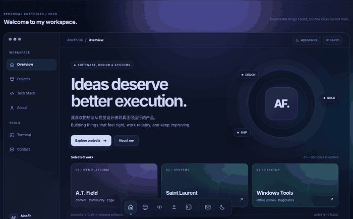

<!-- AincFh OS / profile entrance. Full interactions live in docs/index.html. -->

  

  <strong>AincFh OS</strong> &nbsp;·&nbsp; Design × Engineering &nbsp;·&nbsp; Personal Workspace

  <a href="https://aincfh.github.io/AincFh/"><b>Launch interactive workspace</b></a>
  &nbsp;&nbsp;•&nbsp;&nbsp;
  <a href="https://github.com/AincFh?tab=repositories">Projects</a>
  &nbsp;&nbsp;•&nbsp;&nbsp;
  <a href="https://aincfh.dpdns.org">A.T. Field</a>
  &nbsp;&nbsp;•&nbsp;&nbsp;
  <a href="mailto:fhainc@hotmail.com">Contact</a>

  
<b>About · Projects · Tech Stack</b> — accessible text overview

### AincFh — Independent Product Builder

我喜欢把想法从视觉设计做到真正可运行的产品。关注交互体验、产品完整性、技术架构和长期可维护性。

I build software across web platforms, Windows desktop tools and AI-assisted workflows.

**Selected work**
- **[A.T. Field](https://aincfh.dpdns.org)** — Full-stack content and community platform. [Public repository](https://github.com/AincFh/my-anime-blog). React, TypeScript, Cloudflare Workers, D1 and R2.
- **[Saint Laurent](https://yslfivem.com)** — Roleplay community services, legal information queries and internal workflows. Private source. Next.js, Node.js and SQLite.
- **Windows desktop tooling** — Native utilities and diagnostics, private development. C#, .NET, WinForms and WebView2.

**More** · [Bilibili](https://space.bilibili.com/527018775) · [Email](mailto:fhainc@hotmail.com)

<!-- The real interactive application lives at docs/index.html and needs GitHub Pages
configured to publish /docs from the project branch before the launch URL works. -->
