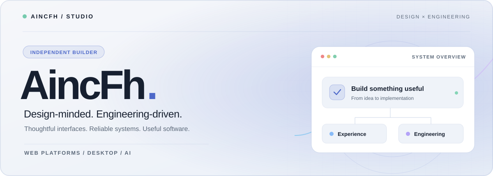
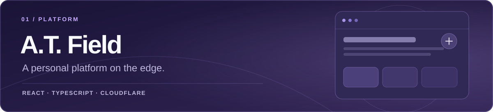
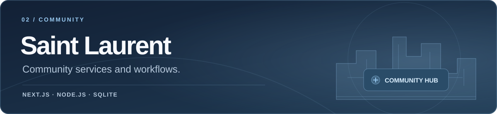
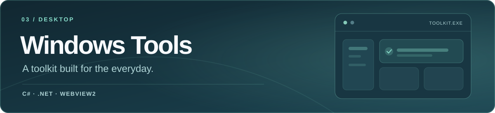

  <picture>
    <source media="(prefers-color-scheme: dark)" srcset="./assets/hero-dark.svg" />
    <source media="(prefers-color-scheme: light)" srcset="./assets/hero-light.svg" />
    
  </picture>

  <a href="https://aincfh.dpdns.org"><strong>Explore A.T. Field</strong></a> &nbsp;·&nbsp;
  <a href="https://github.com/AincFh?tab=repositories">Repositories</a> &nbsp;·&nbsp;
  <a href="mailto:fhainc@hotmail.com">Get in touch</a>

## Hello, I'm AincFh.

**独立开发者 · Full-stack Product Builder**

我喜欢把一个想法从界面设计、应用开发一路做到实际部署。关注的不只是功能能否运行，还有产品是否清晰、顺手、安全，以及能否持续维护。

I work across **web platforms, Windows desktop applications, and AI-assisted workflows** — combining visual detail with practical engineering.

## Selected work / 代表作品

**[A.T. Field · 绝对领域](https://aincfh.dpdns.org)** — [Public repository](https://github.com/AincFh/my-anime-blog)

基于 Cloudflare 的全栈个人内容与社区平台，包含内容展示、用户互动及管理能力。持续完善数据一致性、身份认证、边缘部署和工程化质量门禁。

`TypeScript` · `React` · `Cloudflare Workers` · `D1` · `R2`

**[Saint Laurent · 圣罗兰](https://yslfivem.com)** — Private source

围绕虚构角色扮演社区打造的网站、信息查询与内部工作系统，涉及业务流程、访问控制、智能助手及日常运维。公开链接仅指向社区网站，源代码不公开。

`Next.js` · `Node.js` · `SQLite` · `System integration`

**Windows desktop tooling** — Private projects

探索 Windows 原生客户端、工具箱、诊断流程与嵌入式 Web 界面。重点是稳定的运行体验、清楚的状态反馈，以及可维护的桌面端架构。

`C#` · `.NET` · `WinForms` · `WebView2`

## What I work with / 技术方向

| Direction | Tools & interests |
| :--- | :--- |
| **Frontend & product** | React, Next.js, TypeScript, UX, responsive interfaces |
| **Backend & infrastructure** | Node.js, Cloudflare Workers, D1, SQLite, APIs |
| **Windows desktop** | C#, .NET, WinForms, WebView2 |
| **AI & automation** | AI integrations, agent workflows, workflow orchestration |
| **Engineering quality** | Testing, authorization boundaries, deployment and operations |

## How I build / 工作方式

- **Design for people.** 信息清晰、交互顺手，比堆叠视觉效果更重要。
- **Build for reality.** 重视数据可靠性、权限隔离、错误处理和发布过程。
- **Keep improving.** 通过真实项目和持续迭代验证设计，而不是用自评百分比说明能力。

## Elsewhere / 联系方式

**[GitHub](https://github.com/AincFh)** &nbsp;·&nbsp;
**[A.T. Field](https://aincfh.dpdns.org)** &nbsp;·&nbsp;
**[Bilibili](https://space.bilibili.com/527018775)** &nbsp;·&nbsp;
**[Email](mailto:fhainc@hotmail.com)**

---

  Designed with intention. Built through iteration. 
  破灭的宿命亦是重生的喜悦 · AincFh

