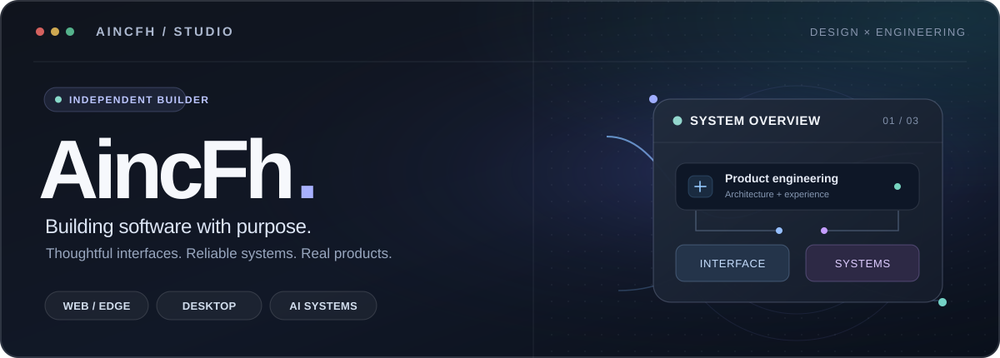

  

  <a href="https://aincfh.dpdns.org"><b>Explore A.T. Field</b></a>
  &nbsp;·&nbsp;
  <a href="https://github.com/AincFh?tab=repositories">Repositories</a>
  &nbsp;·&nbsp;
  <a href="mailto:fhainc@hotmail.com">Contact</a>

# AincFh

**独立开发者 / Full-stack Product Builder**

我专注于把想法做成真正可用的产品：从前端体验、后端架构到部署运维，兼顾视觉细节、可维护性和可靠性。

I build practical software across **web platforms, desktop tools, and AI-assisted workflows** — with a focus on thoughtful interfaces and dependable engineering.

---

## Selected work · 代表作品

### 01 / [A.T. Field — 绝对领域](https://aincfh.dpdns.org)

**全栈内容与社区平台** · [Source code](https://github.com/AincFh/my-anime-blog)

基于 Cloudflare 的个人内容平台，涵盖文章、媒体内容、互动功能与管理后台。围绕真实部署持续完善认证、数据一致性、发布流程和产品体验。

`TypeScript` · `React` · `Cloudflare Workers` · `D1` · `R2` · `Tailwind CSS`

### 02 / [Saint Laurent — 圣罗兰平台](https://yslfivem.com)

**社区服务与业务管理系统** · Private development

面向角色扮演社区的 Web 平台及配套业务工具，涉及内容查询、内部工作流、权限边界、自动化与系统集成。仓库为私有项目；此处仅展示公开站点和项目概述。

`Next.js` · `Node.js` · `SQLite` · `Automation`

### 03 / Windows desktop tooling

**桌面客户端与诊断工具** · Private development

探索原生 Windows 应用、嵌入式 Web 界面、桌面工具集成与系统诊断，注重桌面端的稳定性、易用性和工程化交付。

`C#` · `.NET` · `WinForms` · `WebView2`

---

## What I work with · 技术方向

| Area | Focus |
| :--- | :--- |
| **Product & Frontend** | TypeScript, React, Next.js, UI/UX, responsive interfaces |
| **Backend & Data** | Node.js, SQLite, Cloudflare Workers, D1, API design |
| **Desktop** | C#, .NET, WinForms, WebView2, Windows tooling |
| **AI & Automation** | AI-assisted development, agent workflows, practical integrations |
| **Engineering** | Security boundaries, testability, deployment workflows, observability |

## How I build · 工作理念

- **Experience matters.** 界面应该清晰、克制、好用，而不只是展示技术效果。
- **Engineering matters.** 关注权限、安全、数据一致性与长期可维护性。
- **Shipping matters.** 以真实使用和持续迭代验证方案，不用虚构的技能百分比代替作品。

## Elsewhere · 联系与更多内容

[**GitHub**](https://github.com/AincFh) · [**A.T. Field**](https://aincfh.dpdns.org) · [**Bilibili**](https://space.bilibili.com/527018775) · [**Email**](mailto:fhainc@hotmail.com)

---

  Designed with intention. Built through iteration. · AincFh

