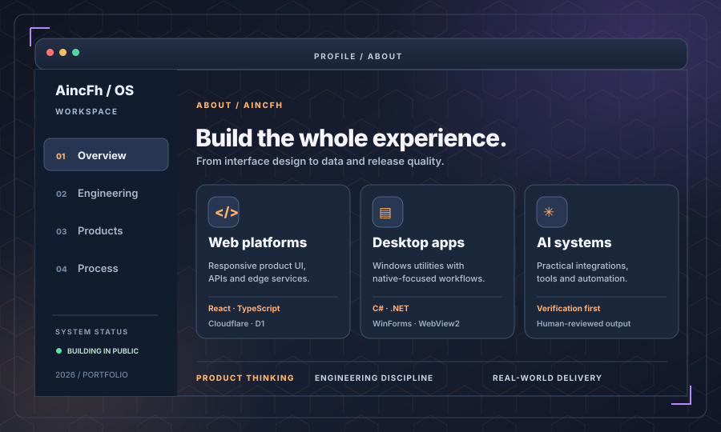
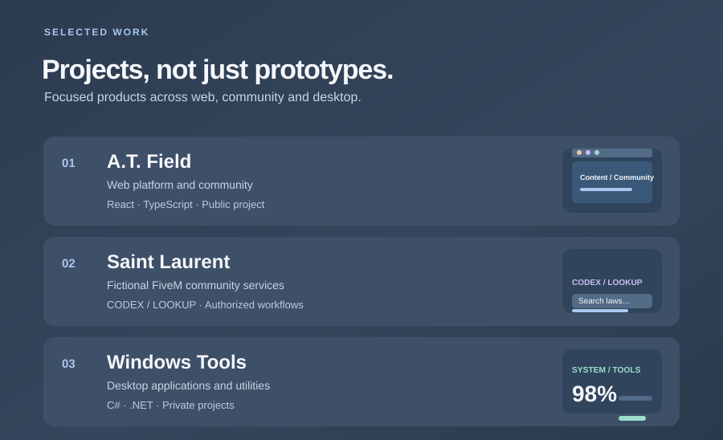
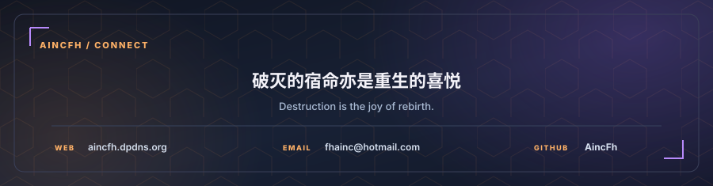

<!--
AincFh — personal engineering and design profile.
Visual-first presentation built with repository-local animated SVG assets.
Interaction inside GitHub README is limited to links, details and supported image animations.
The complete interactive site is stored at docs/index.html and published separately when GitHub Pages succeeds.
GitHub Markdown sanitizes JavaScript, so this README does not claim to embed a functional web desktop.
Projects: https://github.com/AincFh/my-anime-blog · https://yslfivem.com · https://github.com/AincFh
-->

  

  

  

  

  

  

Accessible text / 无障碍文字概览

### AincFh · Independent Product Builder

面向网页、桌面工具与 AI 辅助工作流程开发产品。重视设计一致性、身份与权限边界、系统可靠性和真实交付。

- **[A.T. Field](https://aincfh.dpdns.org)**：公开的个人内容与社区平台，基于 React、TypeScript、Cloudflare Workers、D1 和 R2；[代码仓库](https://github.com/AincFh/my-anime-blog)。
- **[Saint Laurent](https://yslfivem.com)**：FiveM 虚构角色扮演社区平台与内部授权工具；源码非公开，不代表真实政府机构。
- **Windows Tools**：基于 C#、.NET、WinForms 和 WebView2 的桌面应用及诊断工具方向（私有项目）。

**[GitHub](https://github.com/AincFh)** · **[A.T. Field](https://aincfh.dpdns.org)** · **[Bilibili](https://space.bilibili.com/527018775)** · **[Email](mailto:fhainc@hotmail.com)**

